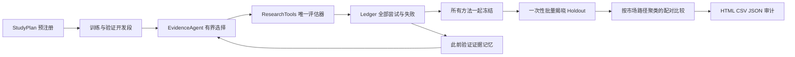

# 架构与交付边界

本项目独立编写研究运行时，保留已有A股工程和委员会研究工程。上游参考快照不参与运行。

## 关键接口

- `StudyPlan`：问题、候选目录、每方法预算、拆分长度、费用、评分和检验设置。Pydantic禁止未知字段，候选窗口严格为整数。
- `PricePath.known(end)`：截止日期上仍不可得的完整日线阻断研究；评估器进一步逐个历史滚动窗口检查执行时点可得性。
- `evaluate(bars, candidate, start, stop, cost_bps)`：严格暖机，逐日执行下一开盘交易，从现金1开始，手续费直接记账，收盘估值。
- `ResearchTools.evaluate(proposal)`：只收到截断开发段，无holdout引用；验证候选目录、重复尝试和预算。
- `EvidenceAgent.search(...)`：有界“提议—测试—反馈”选择；当前为三种可解释的离线政策，无LLM。
- `Ledger.freeze(...)`：检查三个方法各完成同样预算、赢家是已评估的验证集最佳项，然后冻结。
- `Ledger.frozen_winners(...)`：仅对已冻结且未揭晓批次开放；研究协调器随后一次评估全部方法。
- `Ledger.verify(...)`：事件链、身份表、试验投影和封存状态投影一致性。
- `paired_gate(...)`：显式ID配对；按整条市场路径重采样，保留路径内跨episode依赖。

## 公平比较的口径

候选目录、验证评分、成本模型、每单元预算、实际行情和holdout边界相同。方法差异仅为“先试哪些候选”。搜索种子只改变random方法的候选顺序，不增加统计独立样本。默认每个数据种子生成一条不同的人工价格轨迹，统计聚类单元是该轨迹。

验证评分为验证净收益减两倍最大回撤，事先写入实现和代码哈希。每个episode包含训练、验证、holdout，训练段提供共同暖机；验证段可用于选择候选，所以它不是最终样本外证据。只有所有方法选择冻结后，holdout才提供最终配对结果。历史记忆只含memory方法此前已结束episode的验证证据，不包含holdout收益。

统计主指标为净收益差；不把夏普阈值称为已实现的DSR。Bonferroni只覆盖两个预注册方法比较。它不校正同一研究者在多个项目或多轮改代码后选择性报告的全部自由度。符号翻转检验（≤20个非零簇精确穷举，更多时固定种子蒙特卡洛99,999次、加一修正）依赖簇独立与零假设下符号对称性；至少6个独立簇才能达到两个比较校正后的0.05门槛。默认真实路径按重叠测试窗口聚类，暖机 episode 预先排除并单列。

## 可信边界

应用层限制用于防止流程中的意外泄漏，不防止能修改Python或数据库的本地操作者。事件链和导出检查点可检测普通篡改，但同时控制数据库、报告和检查点的人能够伪造整个记录；公开预注册、外部签名与远端保管不在当前实现中。

账本采用SQLite事务锁，并原子记录试验及对应事件；没有实现分布式运行、恢复中断的holdout计算或强对抗的安全沙箱。失败后可保留部分审计用于排查，新实验使用新目录。

## 后续扩展

真正的LLM候选选择器需要实现受限ID协议，并把实际调用、模型版本、输入快照、调用预算单独记录，再与离线方法作等评估预算比较。国内数据适配、完整A股撮合、行业因子、公开前瞻承诺与本地LLM不在本版完成声明内。
